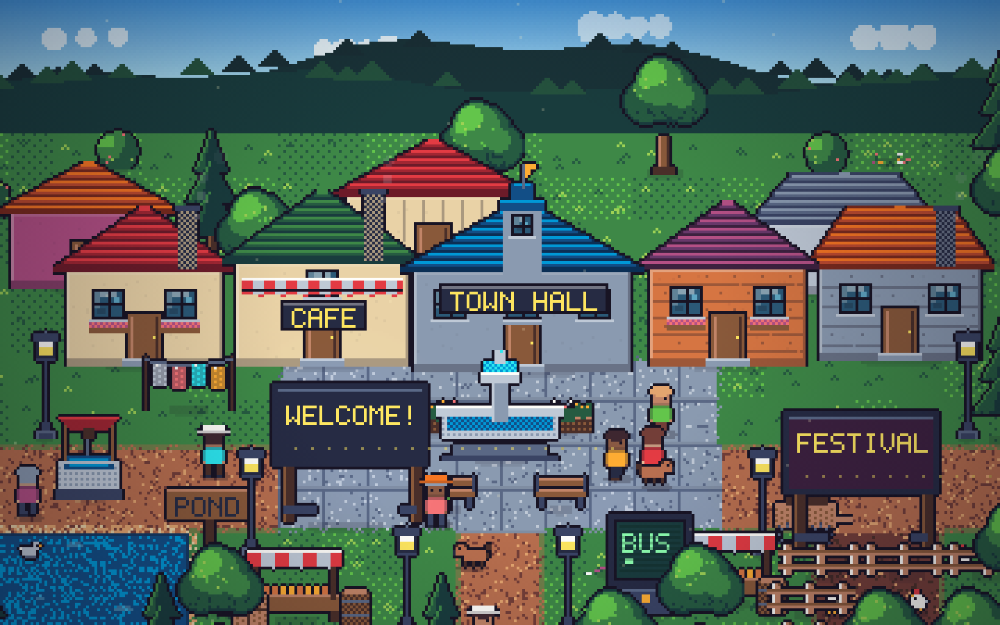

# Pixel Town

An 8-bit town rendered on a single `<canvas>`: houses, a square with a fountain,
street lamps, villagers, animals, billboards and a CRT kiosk, under a day/night
cycle and four weather states.

No build step, no dependencies, no image assets. Every sprite is generated at
runtime from a small fixed palette and a handful of drawing primitives.



## Run it

The page loads ES modules, so it needs to be served over HTTP (opening
`index.html` directly shows a hint instead of the town).

```bash
npm install
npm run dev          # http://localhost:5173
```

Vite is the only toolchain dependency. The app itself has no runtime
dependencies: nothing is imported from `node_modules`, and no build step is
needed to read or edit the code. Any static server still works too
(`python -m http.server 8000`) if you would rather not install anything.

### Production build

```bash
npm run build        # -> dist/
npm run preview      # serves dist/ on http://localhost:4173
```

`dist/` is one ~49 kB JS file plus the HTML (~17 kB gzipped). `base: './'` in
`vite.config.js` keeps the asset paths relative, so the folder can be dropped
under any subpath. It still needs to be served over HTTP: there is no
single-file plugin inlining the bundle.

## Controls

The panel in the bottom-left corner:

- **time slider** - jump to any hour (this also turns off the automatic cycle)
- **clear / rain / snow / fog** - weather, cross-faded
- **auto** - let the day/night cycle run (a full day takes 200 s)
- **pause** - freeze the simulation
- **hide** - hide the panel

Keyboard: `1`-`4` weather, `space` pause, `←`/`→` shift one hour, `a` auto,
`h` hide the panel.

### URL parameters

Useful for screenshots and for opening a specific moment:

| param | meaning | example |
| --- | --- | --- |
| `hour` | starting hour (0-24, decimals allowed) | `?hour=21.5` |
| `weather` | `clear`, `rain`, `snow`, `fog` | `?weather=snow` |
| `auto` | `0` keeps the time frozen | `?hour=9&auto=0` |
| `hud` | `0` hides the panel | `?hud=0` |
| `paused` | `1` starts paused | `?paused=1` |
| `speed` | time multiplier | `?speed=3` |
| `seed` | world seed (same seed, same town) | `?seed=42` |

`window.__town` is exposed for tinkering from the console, e.g.
`__town.state.hour = 23` or `__town.setWeather('snow')`.

## How it renders

The canvas has a **logical** size of a few hundred pixels. Each frame is drawn
at that size and then upscaled by an integer factor with
`image-rendering: pixelated`, so pixels stay square. The logical size adapts to
the window: the renderer picks the smallest integer scale that keeps the world
covering the whole viewport, then grows the viewport until there are no bars.
That means the page never shows letterboxing - on very wide or very tall
windows it crops instead, keeping the town square in frame.

Per frame, layers are painted back to front:

1. sky gradient + stars, sun/moon arc, drifting clouds
2. baked backdrop (hills and distant treeline)
3. baked ground (grass, roads, plaza stone, pond, decals, contact shadows)
4. animated water highlights
5. depth-sorted objects and entities (buildings, props, panels, villagers, animals)
6. chimney smoke
7. weather wash and fog
8. lighting pass (`multiply` of an ambient-colour lightmap with additive lights)
9. lamp/screen bloom, vignette, rain and snow in front of everything

The lightmap is what drives the mood: a colour that goes from warm white at noon
to deep blue at night, with radial lights punched in for lamps, windows, doors,
billboards, the CRT and the fountain. Weather multiplies the ambient colour, so
rain dims the day and snow brightens it.

## Layout

```
index.html          page shell, HUD markup and styles
vite.config.js      dev/preview ports and a relative build base
package.json        scripts: dev, start, build, preview, smoke
src/main.js         bootstrap, resize/scaling, loop, HUD, keyboard, URL params
src/world.js        town map, buildings, props, lights, walkability
src/sprites.js      every sprite generator (buildings, trees, props, people, animals, panels)
src/render.js       layer pipeline, ground/backdrop baking, panel content, camera
src/lighting.js     ambient/sky curves, lightmap, bloom, vignette
src/weather.js      rain, snow, fog, cross-fade
src/entities.js     village and animal behaviour on the tile grid
src/pixel.js        Painter primitives, offscreen canvas helpers, sprite cache
src/palette.js      the 8-bit palette and colour helpers
src/font.js         5x7 bitmap font used for signs and screens
src/rng.js          seeded RNG (same seed, same town)
tools/smoke.mjs     headless checks (see below)
```

## Changing the town

- **Layout, buildings, props, lights**: `src/world.js`. The terrain is a 28x16
  ASCII map at the top; buildings and props are tables below it.
- **Sprite look**: `src/sprites.js`. Buildings are composed from a parameter
  object (wall/roof palettes, roof style, windows, awning, sign, chimney).
- **Colours**: `src/palette.js` - one small palette keeps the scene coherent.
- **People and animals**: `src/entities.js` for behaviour, `VILLAGER_PALS` in
  `src/sprites.js` for the cast.
- **Mood**: `AMBIENT` and `SKY` keyframes in `src/lighting.js`.

## Checks

```bash
node tools/smoke.mjs     # or: npm run smoke
```

This stubs just enough DOM/canvas to boot the real app in Node and then drives
it: 120 frames render, entities stay inside the world and on walkable tiles,
weather reaches full intensity, all four times of day render, and eight viewport
sizes keep integer scaling without letterboxing.

What it cannot check is how the town *looks*, and it does not cover the bundle.
For both, take deterministic screenshots of `dev` and `preview` and compare them
pixel by pixel - `paused=1&t=0` freezes animation, so the two renders must be
byte-identical:

```bash
# with `npm run dev` and `npm run preview` running
Q='?hour=21&weather=rain&hud=0&paused=1&auto=0&t=0'
chrome --headless=new --window-size=1280,760 --virtual-time-budget=6000 \
  --screenshot=dev.png "http://localhost:5173/$Q"
chrome --headless=new --window-size=1280,760 --virtual-time-budget=6000 \
  --screenshot=build.png "http://localhost:4173/$Q"
```

## Notes and limits

- Narrow portrait windows cannot show a wide town without bars, so the camera
  crops to the square. Very wide windows crop vertically instead.
- No audio, no interaction beyond the panel, no persistence: it is a diorama.
- `dist/` is not a double-clickable file; serving it over HTTP is still required.
- Sprites are cached per parameter set, so changing the seeded layout does not
  leak canvases.
